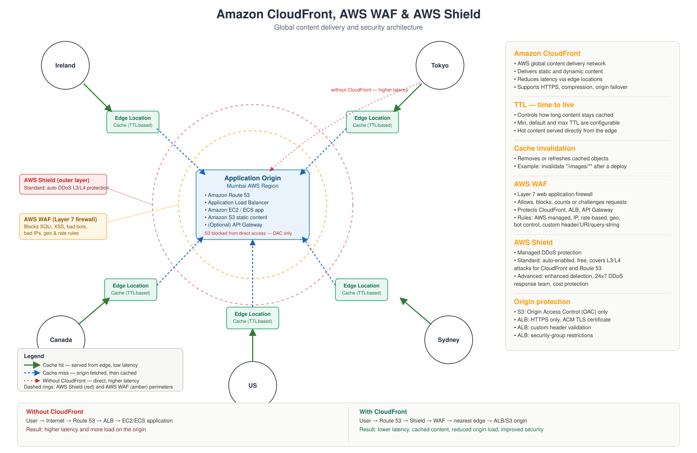

# AWS CloudFront, WAF & Shield — CDN and Edge Security Engineering

<p align="center">
  
</p>

<p align="center">
  <a href="https://github.com/jeevanm84"></a>
  
  
</p>

## What this repository solves

A single origin server means every user, everywhere, pays the same round trip — and every request, cached or not, is a request your backend has to survive. This repository is a hands-on, end-to-end study of the AWS edge stack that fixes both problems:

- **Amazon CloudFront** — caches content at edge locations close to users, cutting latency and origin load.
- **AWS Shield** — absorbs network-layer (L3/L4) DDoS traffic before it reaches your infrastructure.
- **AWS WAF** — inspects application-layer (L7) requests and blocks SQL injection, XSS, bad bots, and abusive traffic patterns.

## Who this is for and what you'll build

You'll come away able to explain, diagram, and reproduce:

- How a CloudFront cache hit differs from a cache miss, and how TTL and invalidation control that behavior
- Why Shield and WAF are complementary, not redundant — one stops volume, the other stops intent
- How to lock an S3 or ALB origin down so only CloudFront can reach it (Origin Access Control, HTTPS-only, security groups)
- How to read and write WAF rules: managed rule groups, rate-based rules, geographic match, and custom conditions

**Can it run locally without a cloud account?** Partially. The diagrams, request-flow walkthroughs, and WAF rule logic in this repo can all be studied and reasoned about with no AWS account. The [labs](labs/) that provision real CloudFront distributions require an AWS account and will incur a small cost — each lab states this upfront and includes cleanup steps.

**Where is the single end-to-end guide?** [`docs/END_TO_END_GUIDE.md`](docs/END_TO_END_GUIDE.md).

## Architecture

The diagram at the top of this README shows the full request path: a global user → Route 53 → Shield → WAF → the nearest CloudFront edge location → the Mumbai origin (Route 53, ALB, EC2/ECS, S3, optional API Gateway). Green arrows are cache hits, blue dashed arrows are cache misses, and the dashed rings represent the Shield and WAF security perimeter.

Full write-up, request-flow sequence, and design rationale: [`docs/ARCHITECTURE.md`](docs/ARCHITECTURE.md).

## Learning path

Three tiers, in order. Don't skip a tier — each one assumes you can already do everything in the tier before it. Every tier states what you need going in and what you'll be able to do coming out.

### Beginner — no AWS account, no cost

**You need:** comfortable with a terminal; no prior CDN, WAF, or DDoS knowledge required.
**You'll come out able to:** explain cache hit vs. miss, TTL, and why Shield and WAF are separate layers — and recognize the pieces in a real Terraform skeleton without applying it.

| Step | Do this |
|---|---|
| 1 | Read [`docs/ARCHITECTURE.md`](docs/ARCHITECTURE.md) — request flow, design decisions, trade-offs |
| 2 | Study [`diagrams/cloudfront-waf-shield-architecture.svg`](diagrams/cloudfront-waf-shield-architecture.svg) until you can redraw the request flow from memory |
| 3 | Read (don't apply) [`examples/terraform/main.tf`](examples/terraform/main.tf) — a minimal, commented CloudFront + S3 + OAC + WAF skeleton |
| 4 | Answer the Fundamentals section of [`docs/INTERVIEW_QUESTIONS.md`](docs/INTERVIEW_QUESTIONS.md) from memory |

### Intermediate — requires an AWS account, small real cost

**You need:** an AWS account, AWS CLI configured locally, and — before you touch anything else — a billing alarm and an IAM user with least-privilege permissions (never use the root account for these labs). Approximate per-lab cost is in [`docs/COST_AND_CLEANUP.md`](docs/COST_AND_CLEANUP.md); its master checklist has a billing-alarm reminder, but set one up now, before you provision anything, not after.
**You'll come out able to:** stand up and lock down a CloudFront distribution, and tell WAF and Shield apart by what each one actually catches.

| Step | Do this |
|---|---|
| 1 | [`labs/01-cloudfront-cache-hit-miss.md`](labs/01-cloudfront-cache-hit-miss.md) — CloudFront in front of S3, cache hit vs. miss, invalidation |
| 2 | [`labs/02-waf-block-sqli-xss.md`](labs/02-waf-block-sqli-xss.md) — attach a Web ACL, write a rate-based rule, safely trigger a block |
| 3 | Answer the Intermediate section of [`docs/INTERVIEW_QUESTIONS.md`](docs/INTERVIEW_QUESTIONS.md) |
| 4 | Run the cleanup command for each lab immediately after finishing it — don't wait until the end |

### Advanced — production reasoning, no new spend

**You need:** the Intermediate tier done and cleaned up.
**You'll come out able to:** reason like an on-call engineer about a live WAF false-positive or DDoS event, and justify Shield Standard vs. Advanced with evidence instead of a guess.

| Step | Do this |
|---|---|
| 1 | [`labs/03-shield-ddos-simulation-safe.md`](labs/03-shield-ddos-simulation-safe.md) — Shield Standard vs. Advanced, no live attack traffic |
| 2 | Check every item in [`docs/SECURITY.md`](docs/SECURITY.md) against what you built in the Intermediate tier |
| 3 | Work [`docs/TROUBLESHOOTING.md`](docs/TROUBLESHOOTING.md) — incident-style scenarios: stale cache after deploy, WAF false positives, origin still publicly reachable |
| 4 | Answer the Advanced through Architect/SRE sections of [`docs/INTERVIEW_QUESTIONS.md`](docs/INTERVIEW_QUESTIONS.md) without re-reading the architecture doc first |

**Full walkthrough of all three tiers as one continuous path:** [`docs/END_TO_END_GUIDE.md`](docs/END_TO_END_GUIDE.md).

## Quick local verification

No AWS account needed to check the repository itself is internally consistent:

```bash
git clone https://github.com/jeevanm84/aws-cloudfront-waf-shield-cdn-security.git
cd aws-cloudfront-waf-shield-cdn-security
python3 scripts/check.py
```

This validates Markdown structure, local links, and that no employer, account, or credential data is committed.

## Repository map

```text
aws-cloudfront-waf-shield-cdn-security/
├── README.md
├── docs/
│   ├── ARCHITECTURE.md        — request flow, design decisions, trade-offs
│   ├── END_TO_END_GUIDE.md    — single guided path through the whole repo
│   ├── CODE_STRUCTURE.md      — what lives where and why
│   ├── SECURITY.md            — Shield/WAF/OAC design and hardening checklist
│   ├── COST_AND_CLEANUP.md    — what each lab costs and how to tear it down
│   ├── TROUBLESHOOTING.md     — incident-style scenarios and root causes
│   ├── INTERVIEW_QUESTIONS.md — fundamentals through architect-level
│   └── ROADMAP.md             — where this fits in the wider portfolio
├── diagrams/                  — architecture SVG
├── labs/                      — hands-on, cost-aware AWS labs
├── examples/terraform/        — minimal, reviewable IaC skeleton (manual apply only)
├── scripts/check.py           — Markdown/link/identity validation
└── .github/                   — CI, issue templates, PR template, CODEOWNERS
```

## Design decisions and trade-offs

- **Manual apply, no auto-deploy.** The Terraform example is provided to read and run yourself; this repo does not auto-provision billable resources on push. See [`docs/COST_AND_CLEANUP.md`](docs/COST_AND_CLEANUP.md).
- **OAC over legacy OAI.** Origin Access Control is used for S3 origin locking instead of the older Origin Access Identity, matching current AWS guidance.
- **Shield Standard, not Advanced, is demonstrated.** Advanced carries a subscription commitment; this repo explains what it adds without requiring you to pay for it.

## Security, cost, and cleanup boundaries

- Every lab that touches AWS states its approximate cost and a matching teardown command. Details: [`docs/COST_AND_CLEANUP.md`](docs/COST_AND_CLEANUP.md).
- Origin protection (OAC, HTTPS-only, security groups, ACM) is treated as mandatory, not optional, in every example. Details: [`docs/SECURITY.md`](docs/SECURITY.md).
- No credentials, account IDs, or employer-specific data are committed — enforced by `scripts/check.py` and CI.

## Troubleshooting and interview links

- Incident-style scenarios (stale cache after deploy, WAF false positives, origin still publicly reachable): [`docs/TROUBLESHOOTING.md`](docs/TROUBLESHOOTING.md)
- Interview question set with links back to the working evidence in this repo: [`docs/INTERVIEW_QUESTIONS.md`](docs/INTERVIEW_QUESTIONS.md)

## Roadmap position

This repository sits alongside the multi-cloud architecture track in the [`jeevanm84`](https://github.com/jeevanm84) portfolio, extending the AWS networking and security evidence started in `aws-well-architected-production-labs`. See [`docs/ROADMAP.md`](docs/ROADMAP.md) for what's planned next.

## Contribution and support

- Issues are for reproducible defects or improvement proposals; use the templates under `.github/ISSUE_TEMPLATE/`.
- Discussions are for learning questions.
- See [`CONTRIBUTING.md`](CONTRIBUTING.md) and [`SECURITY.md`](SECURITY.md) before opening a pull request.
