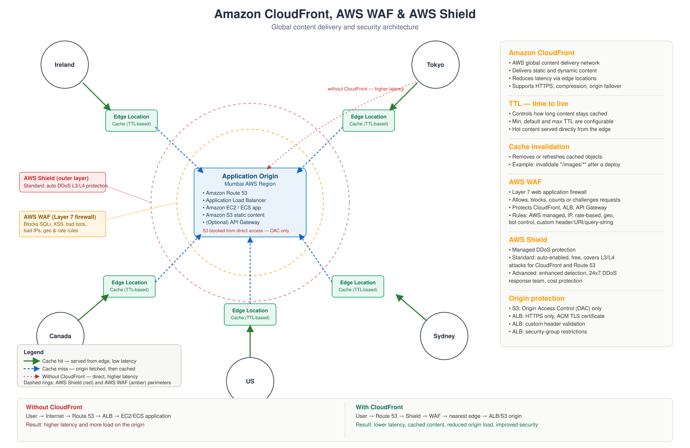

# Architecture

## Problem

A single-region origin means two things are always true: users far from that region pay a long round trip on every request, and every request — even for content that never changes — lands on the origin's compute and database. Neither latency nor origin load scales well as traffic grows or spreads globally.

## Requirements

- Serve static and dynamic content with low latency to users in North America, Europe, and Asia-Pacific from a single Mumbai origin.
- Reduce load on the origin for repeat and shared content.
- Stop network-layer flood attacks before they reach compute.
- Inspect and filter application-layer traffic (SQL injection, XSS, bot abuse, excessive request rates) before it reaches the origin.
- Ensure the origin (S3 and ALB) is unreachable except through the protected CDN path.

## Architecture

<p align="center">
  
</p>

**Origin — Mumbai AWS Region**: Amazon Route 53 for DNS, an Application Load Balancer in front of EC2/ECS, an S3 bucket for static content, and an optional API Gateway origin for API traffic.

**Edge — CloudFront**: A global network of edge locations, one nearest to each user population (Ireland, Canada, US, Tokyo, Sydney in the diagram). Each edge location holds a cache of previously requested objects.

**Perimeter — Shield then WAF**: Every request crosses Shield first (network layer), then WAF (application layer), before it's allowed to reach a CloudFront edge or the origin directly.

## Request flow

### Cache hit (green in the diagram)

```
User → nearest CloudFront edge location → cached object returned
```

The edge already holds a valid copy (within TTL). The origin is never contacted. This is the low-latency path and the one CloudFront is designed to maximize.

### Cache miss (blue, dashed)

```
User → nearest CloudFront edge location → AWS backbone → origin
origin → edge cache (object stored) → user
```

The edge doesn't have a valid copy — either it's never been requested from that edge, or the TTL expired. CloudFront fetches from the origin over AWS's private network (faster and more reliable than the public internet), stores a copy at the edge, and returns it. The next nearby user gets a cache hit.

### Without CloudFront (red, dashed)

```
User → internet → Route 53 → ALB → EC2/ECS application
```

Every request — hot or cold — makes the full trip to Mumbai and hits compute directly. This is the baseline the rest of this repository improves on.

## TTL and cache invalidation

- **TTL (time to live)** determines how long an edge location trusts a cached object before re-validating with the origin. Minimum, default, and maximum TTL are configurable per cache behavior — static assets typically get long TTLs (hours to days), frequently changing API responses get short or zero TTLs.
- **Cache invalidation** forces an immediate refresh of specific paths (for example `/images/*`) after a deployment, rather than waiting for TTL to expire naturally. Invalidations have a cost at scale, so versioned file names (`app.v2.js`) are often preferred over invalidation for high-frequency deploys.

## Security layers

| Layer | Service | Scope | What it stops |
|---|---|---|---|
| Network (L3/L4) | AWS Shield Standard | Automatic, free, always on for CloudFront and Route 53 | SYN floods, UDP reflection, and other common volumetric DDoS patterns |
| Network (L3/L4), enhanced | AWS Shield Advanced | Subscription, opt-in | Larger/sophisticated DDoS, 24×7 AWS DDoS Response Team, cost protection for attack-driven scaling |
| Application (L7) | AWS WAF | Attached to CloudFront, ALB, or API Gateway | SQL injection, XSS, malicious bots, bad IP ranges, geographic restrictions, excessive request rates |

Shield and WAF are complementary rather than redundant: Shield defends against *volume* at the network layer; WAF defends against *malicious intent* in the actual HTTP/HTTPS request content. A large-scale HTTP flood that isn't malformed at the network layer will pass through Shield but should be caught by a WAF rate-based rule.

### WAF rule types used

- AWS Managed Rules (baseline protection against known attack signatures)
- IP allow/deny lists
- Rate-based rules (block a source once it exceeds a request threshold in a time window)
- Geographic match rules
- Bot Control
- Custom rules on header, URI, and query-string values

## Origin protection

- **S3 origin**: locked behind **Origin Access Control (OAC)** — a direct request to the bucket's S3 URL is refused; only CloudFront (presenting a signed request) is permitted.
- **ALB origin**: HTTPS-only listener, a custom origin header CloudFront attaches and the ALB validates, security-group rules that only allow CloudFront's published IP ranges (or the custom-header check) through, and a TLS certificate issued by AWS Certificate Manager.

## Trade-offs

- **Cache freshness vs. origin load.** Longer TTLs reduce origin load and cost but risk serving stale content; this repo defaults to short TTLs for anything that changes per-deploy and long TTLs plus versioned filenames for static assets.
- **Shield Standard vs. Advanced.** Standard is sufficient for the vast majority of workloads and costs nothing extra; Advanced is justified when the cost of an extended outage or the value of the AWS response team's involvement clearly exceeds its subscription cost.
- **WAF rule breadth vs. false positives.** Managed rule groups are a fast baseline but can flag legitimate traffic; this repo's WAF lab includes a step for reviewing "count" mode output before switching a rule to "block."

## Next

Follow the guided path in [`END_TO_END_GUIDE.md`](END_TO_END_GUIDE.md), or jump straight to a lab in [`../labs/`](../labs/).
